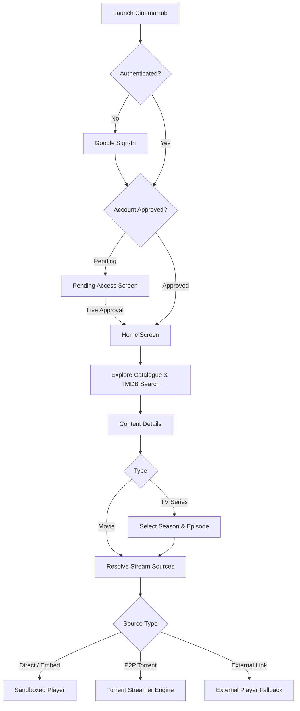

<div align="center">

# 🎬 CinemaHub

### *The Private Streaming Platform for You & Your Friends*

[-3DDC84?style=for-the-badge&logo=android&logoColor=white)](https://github.com/nadeemalam178/cinemahub)
[](https://flutter.dev)
[](https://firebase.google.com)
[](LICENSE)

<br/>

**CinemaHub** is a private, invite-only cinematic streaming application built with Flutter and Firebase. It combines an Apple TV / Letterboxd inspired aesthetic with gatekeeper access control, multi-source streaming scrapers, zero-ad sandboxed playback, and seamless TV season/episode browsing.

</div>

---

## 🌟 Highlights

<table>
  <tr>
    <td width="50%">
      <h3>🛡️ Zero-Ad Sandboxed Video Player</h3>
      <ul>
        <li><b>Isolated Web Sandbox:</b> Blocks 100% of popups, rogue tabs, and redirect scripts at the engine level using sandbox controls.</li>
        <li><b>Anti-Clickjacking Protection:</b> Disables transparent click-stealing overlays while preserving video player controls.</li>
        <li><b>Native & Direct Play:</b> Hardware-accelerated native playback for direct MP4/HLS streams.</li>
      </ul>
    </td>
    <td width="50%">
      <h3>⚡ Multi-Source Scraping Engine</h3>
      <ul>
        <li><b>Direct & Fast Embeds:</b> Automated multi-server scrapers for instant, buffer-free playback.</li>
        <li><b>P2P Magnet Streaming:</b> Direct torrent streaming with real-time peer & health stats.</li>
        <li><b>Stremio-Compatible Addons:</b> Extensible architecture supporting community manifests.</li>
      </ul>
    </td>
  </tr>
  <tr>
    <td width="50%">
      <h3>📺 TV Series Seasons & Episodes</h3>
      <ul>
        <li><b>Interactive Season Picker:</b> Seamlessly navigate seasons for any TV series.</li>
        <li><b>Episode Backdrops:</b> High-resolution TMDB stills, descriptions, and episode numbering.</li>
        <li><b>Smart Stream Routing:</b> Auto-resolves season and episode parameters to fetch the exact source.</li>
      </ul>
    </td>
    <td width="50%">
      <h3>📲 In-App OTA Auto-Installer</h3>
      <ul>
        <li><b>Semantic Version Tracking:</b> Automatic update checks against GitHub Releases.</li>
        <li><b>Live Progress HUD:</b> Real-time transfer stats and progress indicators.</li>
        <li><b>Android FileProvider Handoff:</b> Direct handoff to Android's native package installer.</li>
      </ul>
    </td>
  </tr>
  <tr>
    <td width="50%">
      <h3>🎨 Minimalist Cinematic Design</h3>
      <ul>
        <li><b>Apple TV Inspired Aesthetics:</b> High-contrast obsidian canvas (`#08080E`) with ruby red brand accents.</li>
        <li><b>GPU-Optimized Surfaces:</b> Fluid 60fps animations with lightweight elevation rather than nested GPU blurs.</li>
        <li><b>Shimmer Skeletons:</b> High-polish skeleton loading placeholders across home and catalogue lists.</li>
      </ul>
    </td>
    <td width="50%">
      <h3>🔐 Gatekeeper Access & Google Sign-In</h3>
      <ul>
        <li><b>Modern Credential Manager:</b> Official, non-blocking Google Sign-In flow with cryptographic token validation.</li>
        <li><b>Invite-Only Approval:</b> Pending user queue with administrative access approval via Firestore.</li>
        <li><b>Live Sync:</b> Real-time listener transitions approved users into the app instantly.</li>
      </ul>
    </td>
  </tr>
</table>

---

## 🧭 Source Categories

| Category | Type | Description |
|---|---|---|
| **Direct & Embeds** | Direct HTTP & Sandboxed Embeds | Verified fast embeds and direct cloud servers with zero popup ads |
| **P2P Torrents** | Magnet / P2P | BitTorrent streaming with seeder tracking and multi-resolution options |
| **All Sources** | Aggregated | Consolidated provider list with speed, quality, and audio badges |

---

## 📱 Architecture Flow



---

## 🛠️ Technology Stack

| Layer | Technologies |
|---|---|
| **Frontend Framework** | [Flutter 3.47.9](https://flutter.dev) (Dart 3.13.7) |
| **State Management** | [Provider](https://pub.dev/packages/provider) + [GoRouter](https://pub.dev/packages/go_router) |
| **Authentication** | [Firebase Auth](https://firebase.google.com/docs/auth) & [Google Sign-In](https://pub.dev/packages/google_sign_in) |
| **Database & Security** | [Cloud Firestore](https://firebase.google.com/docs/firestore) with restricted security rules |
| **Metadata Engine** | [The Movie Database (TMDB) API v3](https://developer.themoviedb.org) |
| **Video Playback** | Sandboxed `webview_flutter`, `video_player`, `chewie` |
| **P2P Streaming** | `torrent_streamer` native engine |
| **OTA Updates** | GitHub Releases API + Android `FileProvider` |

---

## ⚙️ Building from Source

### Prerequisites
* Flutter SDK `3.47.9+`
* Java JDK `17+`
* Android SDK (API 34+)

```bash
# 1. Clone repository
git clone https://github.com/nadeemalam178/cinemahub.git
cd cinemahub

# 2. Get dependencies
flutter pub get

# 3. Run analyzer & tests
flutter analyze
flutter test

# 4. Run on connected Android device or emulator
flutter run --dart-define=TMDB_API_KEY=YOUR_TMDB_API_KEY
```

---

## 📄 License

This project is licensed under the [MIT License](LICENSE).
